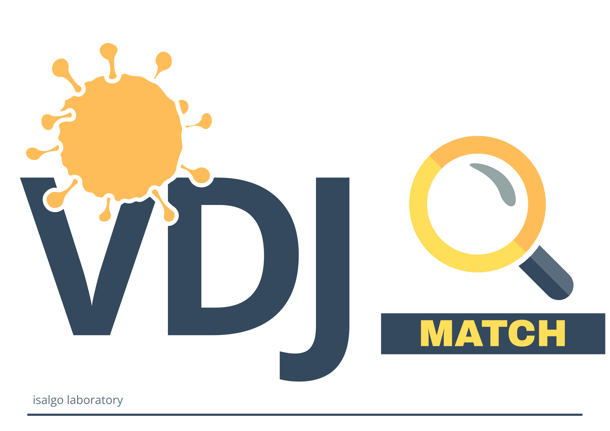
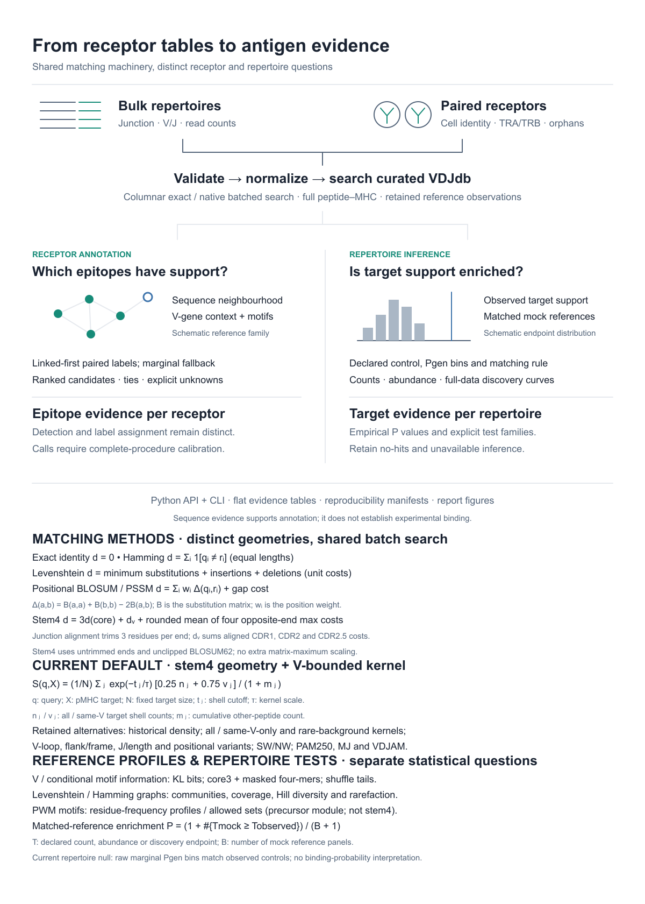

<p align="center">
  <picture>
    <source media="(prefers-color-scheme: dark)" srcset="assets/vdjmatch_dark.svg">
    <source media="(prefers-color-scheme: light)" srcset="assets/vdjmatch_light.svg">
    <!-- Absolute PNG fallback: PyPI strips <picture>/<source> and cannot render a relative or
         raw-served SVG, so the logo must be an absolute-URL raster here. GitHub uses the SVG sources.
         Use the light (dark-on-transparent) raster so it reads on PyPI's white page. -->
    
  </picture>
</p>

<h1 align="center">vdjmatch — TCR peptide–MHC annotation</h1>

<p align="center">
  <a href="https://pypi.org/project/vdjmatch/"></a>
  <a href="https://github.com/antigenomics/vdjmatch/actions/workflows/tests.yml"></a>
  <a href="https://docs.isalgo.dev/vdjmatch/"></a>
  
  <a href="LICENSE"></a>
</p>

`vdjmatch` annotates selected T-cell receptors and repertoires against
[VDJdb](https://github.com/antigenomics/vdjdb-db), preserving query identities and
reporting peptide–MHC candidates, competing evidence and optional background calibration.
Native sequence search uses [`seqtree`](https://github.com/antigenomics/seqtree);
repertoire ingestion reuses published `vdjtools` readers.
Requires released `seqtree>=1.3.2` and `vdjtools>=5.6.0`, including allocation-aware
native thread validation.

<p align="center">
  <picture>
    <source media="(prefers-color-scheme: dark)" srcset="assets/algorithm-overview-dark.svg">
    <source media="(prefers-color-scheme: light)" srcset="assets/algorithm-overview.svg">
  
  </picture>
</p>

## Quick start

```sh
python -m pip install vdjmatch
vdjmatch annotate sample.tsv -o annotation
```

Use AIRR `junction_aa` (including conserved anchors) and V calls. The curated
VDJdb reference is fetched on first use; add `--vdjdb reference.zip` for offline
input. Single TRA/TRB receptors and paired receptors are supported. Exact hits
are retained by default. Scores describe sequence evidence, not proof of binding.

For a small offline example, download the [examples directory](examples/) and run
`sh examples/annotate.sh annotation-demo` from the repository root.

## Choose a reference

The existing `match` command and `Annotator` API support three reference choices:

| Reference | Python | CLI |
| --- | --- | --- |
| Official vdjdb-db release | `Annotator.latest()` | `vdjmatch match queries.tsv` |
| Your VDJdb-format table/archive | `Annotator.from_path("reference.tsv")` | `vdjmatch match queries.tsv --reference reference.tsv` |
| Your labeled chains or pairs | `Annotator.from_labels(rows, locus="TRB")` | `vdjmatch match queries.tsv --reference labels.csv --reference-format labels --locus TRB` |

`--vdjdb` remains an alias for `--reference`. Ordinary queries retain exact matches.
Use `--exclude-exact` only when explicitly evaluating a classifier or assessing
record reliability; it filters hits while retaining the complete reference model.

A simple single-chain reference needs `junction_aa,label` (or `epitope` instead of
`label`). Supply `--locus TRA/TRB` or a reference `locus` column. For paired tables,
use `junction_aa_alpha,junction_aa_beta,label` and add `--paired`; each reference row
links its actual TRA/TRB pair. V/J, species and MHC metadata are optional. Missing
query locus fields use the explicit hint or the reference's sole locus; supplied
query metadata is retained. The sequences include conserved junction anchors.

```python
from vdjmatch import Annotator

single = Annotator.from_labels([("CASSQYF", "class-a"), ("CATSRYF", "class-b")], locus="TRB")
calls = single.annotate(["CASSQYF", "CWWWWWWWF"])

paired = Annotator.from_labels([("CAVQYF", "CASSQYF", "class-a")])
```

Labeled references are indexed directly without VDJdb-specific curation or
reference-diagnostic preparation. Their labels are opaque class names, reported
in the existing `epitope` output fields. They default to uncalibrated matching;
request `--evalue` with the appropriate organism/controls for calibration.
Run [the synthetic single/paired example](examples/labeled_references.py) for a
complete Python example.

## Documentation

| Need | Guide |
| --- | --- |
| Learn the workflow | [Getting started](https://docs.isalgo.dev/vdjmatch/tutorial.html) · [Rendered notebooks](https://docs.isalgo.dev/vdjmatch/notebooks.html) |
| Annotate a cohort or use an offline reference | [How-to guides](https://docs.isalgo.dev/vdjmatch/how-to.html) · [Runnable examples](https://docs.isalgo.dev/vdjmatch/examples.html) |
| Look up inputs, options and outputs | [CLI reference](https://docs.isalgo.dev/vdjmatch/cli.html) · [Python API](https://docs.isalgo.dev/vdjmatch/api.html) |
| Understand methods and formulas | [Scoring](https://docs.isalgo.dev/vdjmatch/scoring.html) · [Evidence and calibration](https://docs.isalgo.dev/vdjmatch/explanation.html) |
| Test repertoire enrichment | [Matching, nulls and count units](https://docs.isalgo.dev/vdjmatch/repertoire-method.html) |
| Estimate precursor frequency | [Method](https://docs.isalgo.dev/vdjmatch/pgen.html) · [Experimental compendium](https://docs.isalgo.dev/vdjmatch/compendium.html) |

The legacy Java/Groovy implementation remains on [`legacy-java`](https://github.com/antigenomics/vdjmatch/tree/legacy-java)
and [Java tag 1.3.1](https://github.com/antigenomics/vdjmatch/tree/1.3.1), with
JitPack artifact `com.github.antigenomics:vdjmatch:1.3.1`.

## License

ISALGO LAB Academic and Non-Commercial Research License v1.0. See [LICENSE](LICENSE).

CPU budgets use `threads=0` for automatic parallel work, capped at 16 allocated CPUs.
Use `1` for serial work or a positive
count to override the automatic cap within the scheduler/container allocation.
Sample workers keep their inner numerical kernels serial.

Candidate-only annotation coalesces up to 256 complete query identities and
64 MiB of queued expanded tables per reduction. Native search and alias expansion
keep small blocks; larger complete-query frames are consumed directly.
